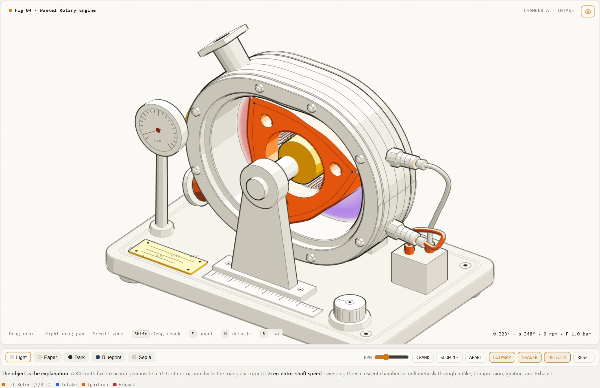
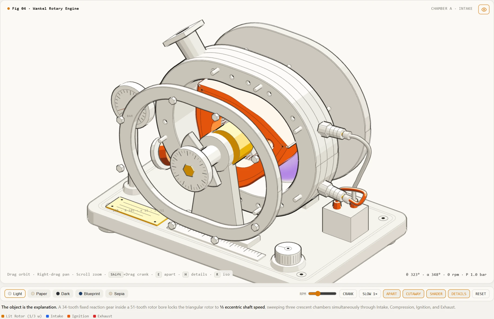
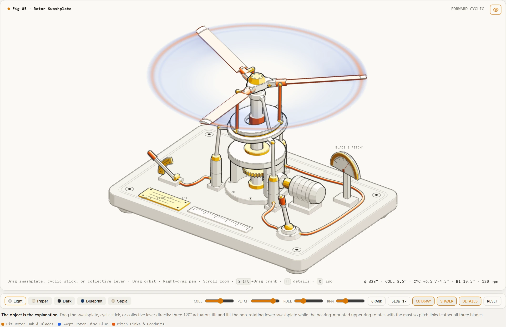
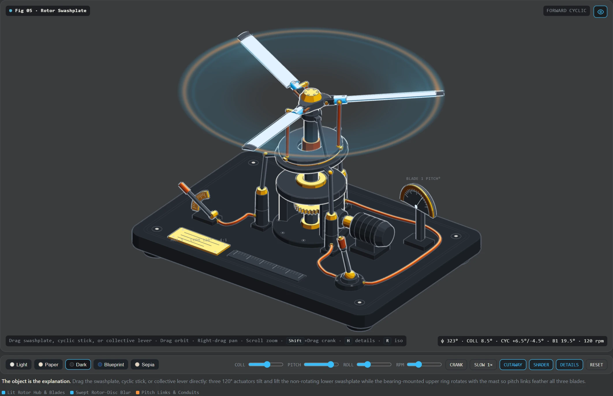
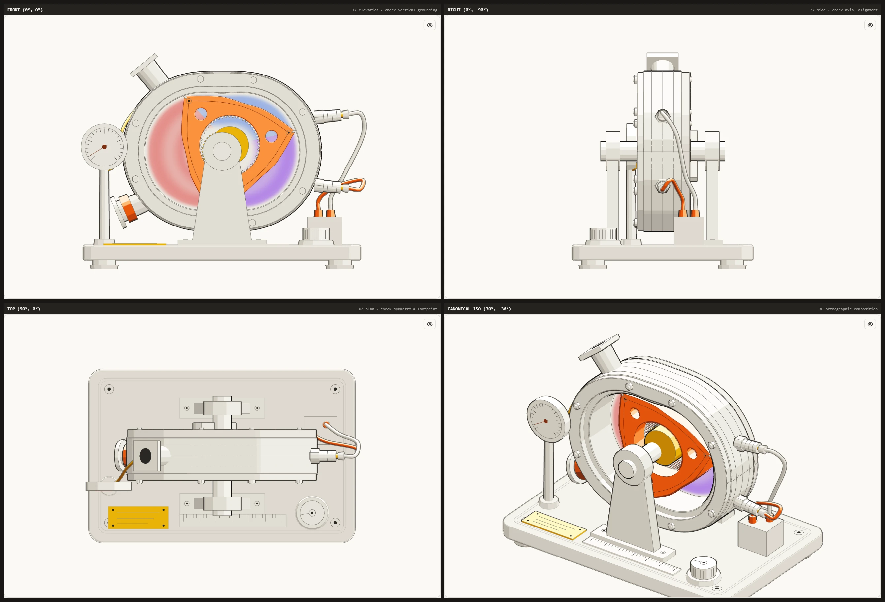
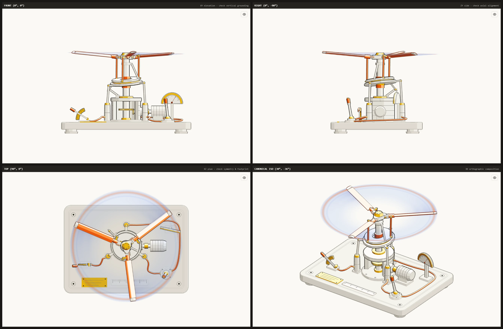
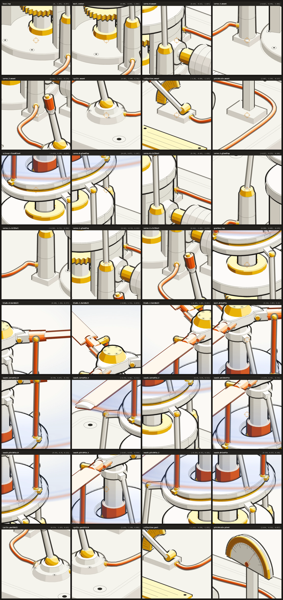
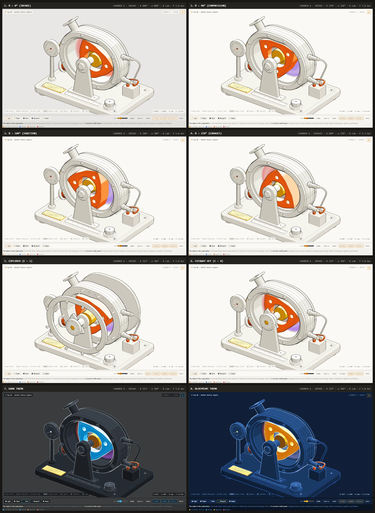

# Anatomy Three.js (`anatomy-threejs`)

> **The object is the explanation.** Interactive, cel-shaded isometric 3D technical figures in **Three.js** and **GLSL**, built through an explicit Stage 0 apparatus brief, a 6-stage modular CAD pipeline, and automated 3D spatial + headless Chrome verification.

`anatomy-threejs` adapts and re-architects [Ryan's original `anatomy` SVG skill](https://skills.wheresryan.sh/anatomy) into native real-time 3D WebGL. Rather than drawing flat boxes and label arrows—or asking an LLM to hallucinate a monolithic 1,500-line Three.js script in one shot—it guides the agent to build a tangible bench-top apparatus whose physical mechanics **are** the explanation:

- **Four-tone + top-cap quantized cel shading** (`lo`, `mid`, `hi`, `lit`, `brass`, `copper` ramps across 5 switchable themes: `Light`, `Paper`, `Dark`, `Blueprint`, `Sepia`)
- **Ink linework in true 3D**: backface inverted-hull silhouettes + `THREE.EdgesGeometry` crease lines
- **Confined GLSL physical medium shaders** (combustion gas, rotor wake, plasma, fluid, optical beams) strictly masked to active cavities
- **Bespoke operator controls & live telemetry** (`SPEC.controls` sliders, springs, custom gauges/scales) calibrated directly from the mathematical model (`model.mjs`)
- **Direct 3D viewport manipulation** (`reg.interactable`): grab and drag assemblies, sticks, or levers right on the canvas—even when rotation is paused
- **Optional view modes** (`SPEC.features`): `explode` (`E`), `cutaway` (`C`), `shader` (`I`), and `crank` (`Shift`+drag), enabled only when meaningful for the mechanism
- **Two-tier verification harness**: fast headless Node.js 3D spatial audit (`kit/audit3d.mjs`) + zero-dependency headless Chrome CDP visual inspection (`scripts/inspect.mjs` & `scripts/drive.mjs`)

## Gallery

<table>
  <tr>
    <td width="50%"></td>
    <td width="50%"></td>
  </tr>
  <tr>
    <td><sub><b><a href="figures/wankel-engine/">wankel-engine</a></b> (Light): cutaway epitrochoid housing, <code>34:51</code> phasing gearset, routed spark cables, and confined 4-stroke GLSL gas shader.</sub></td>
    <td><sub><b><a href="figures/wankel-engine/">wankel-engine</a></b> (Exploded): axial <code>APART</code> (<code>E</code>) separation across concentric housing, rotor, and shaft layers.</sub></td>
  </tr>
  <tr>
    <td width="50%"></td>
    <td width="50%"></td>
  </tr>
  <tr>
    <td><sub><b><a href="figures/helicopter-swashplate/">helicopter-swashplate</a></b> (Light): grab and drag the swashplate, cyclic stick, or collective lever directly in 3D while watching all three blades feather and the protractor needle track Blade 1.</sub></td>
    <td><sub><b><a href="figures/helicopter-swashplate/">helicopter-swashplate</a></b> (Dark): 5 switchable themes (<code>Light</code>, <code>Paper</code>, <code>Dark</code>, <code>Blueprint</code>, <code>Sepia</code>) with theme-aware GLSL shader palettes.</sub></td>
  </tr>
</table>

---

## How `anatomy-threejs` Differs from the Original `anatomy` Skill

Both skills share the same editorial craft philosophy from [`anatomy`](https://skills.wheresryan.sh/anatomy): *the object is the explanation*, high part density at 1× and 4× inspection, a disciplined four-tone hierarchy where one working subject owns the bright accent, spring-eased physics, and rigorous geometry audits. Moving from 2D isometric SVG into native Three.js + GLSL changed how figures are designed, interacted with, structured, and verified:

| Dimension | Original [`anatomy` Skill](https://skills.wheresryan.sh/anatomy) | `anatomy-threejs` |
|---|---|---|
| **Rendering Medium** | Isometric **2D SVG paths** (`iso(x, y, z)`) with precomputed shapes and manual painter's order (`A.settle` depth sorting, back/front geometry splitting). Optional WebGL quads layered into the SVG plane (plus a standalone `turning-dial` 3D mode). | Native **3D Three.js + GLSL**: real solid meshes (`ExtrudeGeometry`, `LatheGeometry`, `TubeGeometry`, `BufferGeometry`), hardware depth buffer, backface inverted-hull silhouettes, and `THREE.EdgesGeometry` crease lines. |
| **Camera & Inspection** | Fixed camera angle baked at build time (azimuth 35–60°, elevation 30–44°). | Interactive orthographic 3D rig: drag to **orbit**, right-drag to **pan**, scroll/pinch to **zoom**, **`R`** to snap back to canonical isometric (`30°` elev, `-36°` azim), and **`Shift`+drag** to crank theta manually. |
| **Direct Part Manipulation** | Controls are usually knobs/slabs/sliders wired to DOM listeners in the SVG scene. | First-class **`THREE.Raycaster` direct 3D drag (`reg.interactable`)** alongside custom **`SPEC.controls`** sliders: drag a swashplate, cyclic gimbal stick, or collective quadrant directly in 3D space while paused (`0 rpm`) or running. |
| **Upfront Planning Gate** | Starts directly at sizing (`Figure` / `Hero` / `Epic`), truth research, and parts list in a build script. | Starts with **Stage 0 — Apparatus & Interaction Brief** to agree upfront on the bespoke bench hardware, what the user can drag directly in 3D, domain-authentic telemetry, and which `SPEC.features` modes make sense before any code is written. |
| **View Modes & Controls** | Fixed card controls + exploded view when applicable. | Per-figure **`SPEC.features`** (`{ explode, cutaway, shader, crank }`) and **`SPEC.controls`**: `shell.html` automatically hides irrelevant controls (e.g., `explode: false` disables `APART` / `E` for open articulated linkages where exploding adds clutter). |
| **Modular Figure Structure** | Framework-free JS (`build.mjs` + geometry/rig modules + `kit/`) or React/Next integration. | Immutable engine in [`kit/`](kit/) + standardized **6-stage CAD pipeline** per figure (`model.mjs`, `base.mjs`, `structure.mjs`, `subject.mjs`, `mechanism.mjs`, `shader.mjs`) compiled into a zero-runtime-dependency single HTML bundle (`dist/<slug>.html`). |
| **Verification Pipeline** | SVG `kit/audit.mjs` (clearances, overlaps, depth keys), `scripts/lines.mjs` (stray stroke ends), `capture.mjs` / `drive.mjs`. | **Tier 1 (`kit/audit3d.mjs`)**: pure-Node 3D triangle-vs-voxel collision checks, grounding (`[FLOATING]`), analytical bore clearance, coaxial port tangents (`[TUBE TANGENT]`), slack ratio (`[TUBE TAUT]`), and arc-length bends (`[TUBE KINK]`) across extreme poses.<br>**Tier 2 (`scripts/inspect.mjs` & `scripts/drive.mjs`)**: headless Chrome CDP renders of a **2×2 Orthographic Quad** (`FRONT`, `RIGHT`, `TOP`, `ISO`), zoomed **Joint Reticle Crops** (`--joints`), an **8-State Drive Contact Sheet** (`SPEC.drivePoses`), and **390px Mobile** layout checks. |

---

## Our Journey So Far

`anatomy-threejs` evolved iteratively as real test figures exposed where LLM-authored 3D diagrams break down:

1. **Breaking 3D Spatial Blindness (`3fa4f04`) — Staged CAD + Automated 3D Audit**
   When asked to generate a 1,500-line Three.js HTML page in one shot, agents routinely hallucinated coordinates: parts floated over the bedplate, intake/exhaust manifolds pointed inward or clipped through solid walls, apex seals penetrated housing bores, and front-panel gauges hid behind the engine at canonical isometric angle.
   To solve this, we extracted the camera rig, 5-theme cel shaders, spring physics, and card chrome into an immutable [`kit/`](kit/) engine, split figure authoring into six small stage modules tested at each gate, built [`kit/audit3d.mjs`](kit/audit3d.mjs) + [`scripts/inspect.mjs`](scripts/inspect.mjs) / [`scripts/drive.mjs`](scripts/drive.mjs), and refactored the reference Wankel Rotary Engine (`figures/wankel-engine/`).

2. **Fixing Taut, Kinked Cables (`7397a6a`) — Port-Normal Tangent Routing**
   Earlier builds interpolated cable waypoints linearly between point anchors, causing wires connecting vertical `+Y` coil towers to horizontal `+X` spark plug boots to exit sideways, cut straight like rigid rods (`length/chord ~ 1.002`), and T-bone into ports at ~90°.
   We extended `reg.anchor()` with local outward port normals (`opts.dir`) and `reg.getAnchorWorldDir()`, updated `reg.tube()` with coaxial `leadOut` / `leadIn` handles and centripetal `CatmullRomCurve3` splines, and added `[TUBE TANGENT]` (`<= 38°`), `[TUBE TAUT]` (`length/chord >= 1.08`), uniform arc-length `[TUBE KINK]`, and narrowphase mesh intersection checks to [`kit/audit3d.mjs`](kit/audit3d.mjs).

3. **Stress-Testing on an Open Linkage (`9fa484d`) — Helicopter Swashplate Rig**
   To validate the skill beyond rotary engines, we built [`figures/helicopter-swashplate/`](figures/helicopter-swashplate/): a 3-blade articulated rotor hub, 4:1 bevel reduction gearbox, 120° CCPM servo actuators, tilting lower/upper swashplate assembly, anti-rotation scissors, pitch control links, and a coning-tracked GLSL rotor-disc blur shader.

4. **Eliminating Cloned Controls, Missing Direct Drag & Unneeded Exploded Views (`b770aa7`)**
   Testing the first helicopter build surfaced three key UX and workflow flaws:
   - **No cloned Wankel hardware**: Even on a helicopter rotor rig, the model had reused the Wankel engine's rotary `knob.drum`, tall pressure gauge, and manifold box. We added bespoke-control rules to [`SKILL.md`](SKILL.md) and [`references/craft-3d.md`](references/craft-3d.md), and replaced the helicopter's cloned controls with a **2-axis Cyclic Stick**, a **Collective Pitch Quadrant Lever**, a **Semi-circular Blade Pitch Protractor Stand**, and **3 Bowden conduits**.
   - **No straight-to-code rushing**: The agent previously jumped straight to building without agreeing on interactions. We added **Stage 0 — Apparatus & Interaction Brief** in [`SKILL.md`](SKILL.md) and added native **`THREE.Raycaster` direct 3D dragging (`reg.interactable`)** + dynamic **`SPEC.controls`** sliders to [`kit/registry.mjs`](kit/registry.mjs) and [`kit/runtime.mjs`](kit/runtime.mjs), so users can grab the swashplate, cyclic stick, or collective lever directly in 3D (even at `0 rpm`) to see the blades feather.
   - **Exploded view shouldn't be mandatory**: Forcing `APART` (`E`) on an open articulated swashplate separated links from their pitch horns without revealing anything hidden. We added **`SPEC.features`** (`{ explode, cutaway, shader, crank }`) so open linkages can cleanly set `explode: false`, removing the `APART` button, skipping exploded audit poses, and omitting `hero-exploded.png` during `drive.mjs`.

---

## How to Use the Skill

### 1. Setup

```bash
git clone https://github.com/Theblackcat98/anatomy-threejs.git
cd anatomy-threejs
npm install
```

- **Dependencies**: Node.js 20+, `three` (`npm install`), and Google Chrome / Edge / Playwright Chromium on `PATH` or via `CHROME_PATH` for Tier-2 visual inspection (`scripts/inspect.mjs` and `scripts/drive.mjs` talk to Chrome over zero-dependency WebSocket CDP).

### 2. Building a New Figure with an AI Coding Agent

Point your coding agent at [`SKILL.md`](SKILL.md) (copy/symlink this repo into your workspace or skill directory and ask it to build an Anatomy 3D figure for your topic). The skill enforces seven gated stages:

| Stage | Module(s) | What Happens & Gate |
|---|---|---|
| **Stage 0** | *(Conversation)* | **Apparatus & Interaction Brief**: Propose the bench apparatus, hero `lit` assembly, direct 3D drag targets (`reg.interactable`), domain-authentic `SPEC.controls` & gauges, and `SPEC.features` (`explode`, `cutaway`, `shader`, `crank`). Wait for user confirmation. |
| **Stage 1** | `model.mjs` + `build.mjs` | **Pure Math & Kinematics**: Define `SPEC`, `ANCHORS`, `SPEC.features`, `SPEC.controls`, `SPEC.auditPoses`, `SPEC.drivePoses`, deterministic state functions, and `formatReadout`.<br>Gate: `node figures/<slug>/build.mjs --test-model` |
| **Stage 2** | `base.mjs` | **Bench Bedplate**: Ground halo, beveled datum slab (`topSurfaceY`), corner feet, ruler, brass plaque, engraved tag, and anchor registration.<br>Gate: `--audit` + `inspect.mjs ... --isolate base --ortho --out ...` |
| **Stage 3** | `structure.mjs` | **Structure & Ports**: Stationary housings, cutaway covers (`cutawayHide: true`), pedestals, and ports with outward `dir` normals.<br>Gate: `--audit` + `inspect.mjs ... --isolate base,structure --ortho --out ...` |
| **Stage 4** | `subject.mjs` | **Hero Moving Subject**: `hi`/`lit`/`brass` core assembly, hierarchical pivot groups, and `insideBoreOf` / `boreClearanceFn` assertions.<br>Gate: `--audit` + `inspect.mjs ... --isolate subject --ortho --out ...` |
| **Stage 5** | `mechanism.mjs` | **Controls, Linkages & 3D Drag**: Bespoke control hardware, calibrated gauges/scales, smooth `reg.tube()` conduits, `reg.interactable()` drag handlers, and `updateKinematics(reg, state)`.<br>Gate: `--audit` + `inspect.mjs --ortho` + `inspect.mjs --joints` |
| **Stage 6** | `shader.mjs` | **Physical Medium Shader & Final Drive**: 5-theme GLSL shader masked to the active medium.<br>Gate: `build.mjs` + `scripts/drive.mjs ... --out ...` + visual review of `hero-*.png`, `inspect-drive.png`, and `mobile-390.png` |

Before coding each stage, agents read [`references/craft-3d.md`](references/craft-3d.md), [`references/kit-3d.md`](references/kit-3d.md), and [`references/verify-3d.md`](references/verify-3d.md). **Rule 1**: never edit [`kit/`](kit/) for a single figure—all figure code lives inside `figures/<slug>/`.

### 3. Running Builds & Verification Locally

Replace `<slug>` with `wankel-engine` or `helicopter-swashplate`:

```bash
# 1. Pure kinematic & anchor verification
node figures/<slug>/build.mjs --test-model

# 2. Pure-Node 3D spatial audit (grounding, collisions, bore clearance, tube tangents/slack/kinks)
node figures/<slug>/build.mjs --audit

# 3. Compile standalone single-file HTML bundle -> figures/<slug>/dist/<slug>.html
node figures/<slug>/build.mjs

# 4. Headless Chrome: 2x2 Orthographic Blueprint Quad (Front, Right, Top, Canonical Iso)
node scripts/inspect.mjs figures/<slug>/dist/<slug>.html --ortho --out figures/<slug>/dist/inspect-ortho.png

# 5. Headless Chrome: 3x zoomed contact sheet of every registered joint & anchor
node scripts/inspect.mjs figures/<slug>/dist/<slug>.html --joints --out figures/<slug>/dist/inspect-joints.png

#    (Optional: isolate a specific stage or subset of joints)
node scripts/inspect.mjs figures/<slug>/dist/<slug>.html --isolate base,structure --ortho --out figures/<slug>/dist/inspect-structure.png
node scripts/inspect.mjs figures/<slug>/dist/<slug>.html --joints --only plug.leading.tip,rotor.eccentric --out figures/<slug>/dist/inspect-focus.png

# 6. Headless Chrome: Full 8-state interactive drive sheet, hero stills & 390px mobile layout verify
node scripts/drive.mjs figures/<slug>/dist/<slug>.html --out figures/<slug>/dist/
```

Every output bundle in `figures/<slug>/dist/<slug>.html` is self-contained and can be opened directly in any modern browser.

---

## Included Reference Figures

### 1. [`figures/wankel-engine/`](figures/wankel-engine/) — Rotary Engine (`13B · R 105 · e 15 · 34:51`)
- **Features**: `explode: true`, `cutaway: true`, `shader: true`, `crank: true`
- **Mechanics**: Epitrochoid housing with `34:51` stationary/rotor phasing gearset, eccentric output shaft, apex seals checked mathematically against the inner bore profile (`boreClearanceFn`), cutaway rotor housing, and confined 4-stroke intake/compression/ignition/exhaust GLSL gas shader.
- **Verification**: Passes Stage 1 model test (`8 anchors`) and Tier-1 3D audit (`72 parts · 3 tubes · 18 joints · 5 poses · 0 problems`), plus `drive.mjs` (`hero-light.png`, `hero-exploded.png`, `hero-dark.png`, `inspect-drive.png`, `mobile-390.png`).

### 2. [`figures/helicopter-swashplate/`](figures/helicopter-swashplate/) — Rotor Swashplate (`MRH-3 · CCPM 120° · 4:1`)
- **Features**: `explode: false` (open articulated linkage), `cutaway: true`, `shader: true`, `crank: true`
- **Direct 3D Interaction & Controls**: Grab and drag the **swashplate assembly**, **2-axis cyclic gimbal stick**, or **collective quadrant lever** directly in the viewport (or tune `COLL`, `PITCH`, `ROLL`, and `RPM` sliders) while watching the **semi-circular Blade 1 pitch protractor needle** and all three airfoils feather smoothly—even paused at `0 rpm`. Includes a 4:1 cutaway bevel gearbox, three 120° CCPM servo pushrods, routed Bowden conduits, anti-rotation scissors, pitch links, and a coning-tracked GLSL swept rotor-disc blur shader.
- **Verification**: Passes Stage 1 model test (`11 anchors`), Tier-1 3D audit (`119 parts · 3 tubes · 32 joints · 5 poses · 0 problems`), `inspect.mjs --ortho` / `--joints`, `drive.mjs` (`8 poses`, no `hero-exploded.png`, `scrolls sideways: no`), and headless CDP pointer-drag verification on `swash.assembly`.

### Verification Outputs (`inspect.mjs` & `drive.mjs`)

Every figure is verified with headless Chrome CDP across orthographic elevations (`--ortho`), zoomed joint reticle crops (`--joints`), and an 8-state interactive drive sheet (`drive.mjs`):

<table>
  <tr>
    <td width="50%"></td>
    <td width="50%"></td>
  </tr>
  <tr>
    <td><sub><b><code>inspect.mjs --ortho</code></b> (<code>wankel-engine</code>): checks vertical grounding, axial alignment, footprint symmetry, and canonical isometric framing.</sub></td>
    <td><sub><b><code>inspect.mjs --ortho</code></b> (<code>helicopter-swashplate</code>): verifies 120° CCPM servo layout, gearbox clearance, and Bowden conduit routing across all four projections.</sub></td>
  </tr>
</table>

<details>
<summary><b>Joint Reticle Crops (<code>--joints</code>) &amp; 8-State Drive Contact Sheet (<code>drive.mjs</code>)</b></summary>

<br>

<table>
  <tr>
    <td width="50%" valign="top"></td>
    <td width="50%" valign="top"></td>
  </tr>
  <tr>
    <td><sub><b><code>inspect.mjs --joints</code></b> (<code>helicopter-swashplate</code>): 3× zoomed crops centered on all 32 registered joints and cable ports.</sub></td>
    <td><sub><b><code>drive.mjs --out</code></b> (<code>wankel-engine</code>): 8-pose contact sheet covering 4-stroke angles, <code>EXPLODED</code>, <code>CUTAWAY OFF</code>, <code>Dark</code>, and <code>Blueprint</code> themes.</sub></td>
  </tr>
</table>

</details>

---

## Repository Structure

```text
anatomy-threejs/
├── README.md                     # Overview, diff from original anatomy skill, journey & usage
├── SKILL.md                      # Agent entrypoint: Stage 0 brief + 6-stage workflow & gates
├── package.json                  # Project config (three dependency)
├── kit/                          # Immutable engine shared by every figure
│   ├── audit3d.mjs               # Node.js 3D collision, grounding, bore, and tube auditor
│   ├── bundle.mjs                # Single-file HTML bundler + CLI --test-model / --audit runner
│   ├── primitives.mjs            # Extruded slabs, cylinders, annular rings, gears, ticks, screws
│   ├── registry.mjs              # Recorder3D scene/anchor/tube/interactable/tag registry
│   ├── runtime.mjs               # Orthographic camera, 3D raycast dragging, springs, __ANATOMY_DEBUG__
│   ├── shaders.mjs               # 5 themes, 4-tone cel + inverted-hull + crease materials
│   └── shell.html                # Framed interactive HTML card template & responsive CSS
├── references/                   # Progressive agent reference docs
│   ├── craft-3d.md               # Coordinate system, tone rules, bespoke hardware, anti-patterns
│   ├── kit-3d.md                 # Recorder3D, primitives, shaders, SPEC.controls/features API
│   └── verify-3d.md              # Diagnosing & fixing audit, ortho, joint-crop & drive findings
├── scripts/                      # Zero-dependency headless Chrome (CDP) verification tools
│   ├── chrome-port.mjs           # Headless Chrome launcher, WebSocket CDP & PNG grid stitcher
│   ├── inspect.mjs               # 2x2 Orthographic Quad (--ortho), isolate & 3x Joint Crops (--joints)
│   └── drive.mjs                 # Hero stills, 8-state drive sheet & 390px mobile layout check
└── figures/
    ├── wankel-engine/            # Enclosed cutaway reference with axial explode & RPM control
    └── helicopter-swashplate/    # Open articulated linkage reference with direct 3D dragging
```
